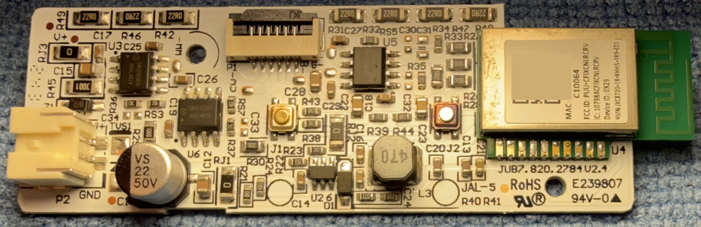
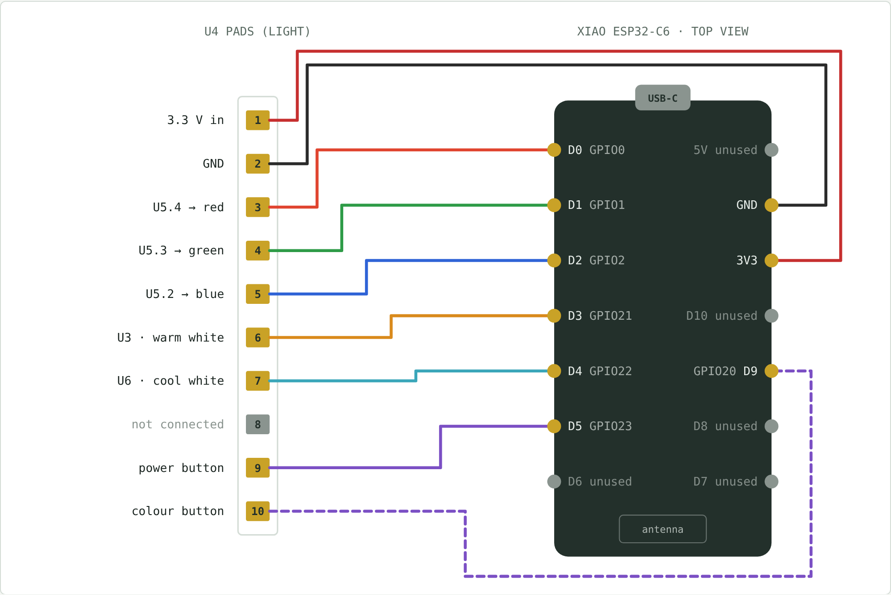

# ESPHome GE Cync ESP32 Modification

Convert a GE **Cync reveal HD+ smart undercabinet light** to ESPHome by
replacing its Wi-Fi/Bluetooth module with a Seeed Studio XIAO ESP32-C6. The
light keeps its own power supply, LED drivers and buttons; only the radio
module changes.

Why:

- **Better low-light dimming.** The stock firmware's PWM is visible at low
  brightness. Here the ESP32-C6 drives the LED drivers with 14-bit PWM at
  4882 Hz, with no visible flicker even with fast movement.
- **Smooth colour changes.** A custom light platform crossfades all five LED
  channels together, so changes between colours and whites don't dip or
  appear to pause on an in-between colour.
- **The buttons in Home Assistant.** Both buttons send tap, double-tap and
  hold events, and can either act on the light or hand control to Home
  Assistant.
- **Fully local.** No cloud, no Matter. Keeps working from its own buttons
  when Home Assistant or Wi-Fi is down.

> Not affiliated with GE, Savant or Cync. Opening the light and replacing the
> module voids its warranty and its listing. Work on it disconnected from
> mains. You do this at your own risk.

## Status

| Item | State |
|---|---|
| Firmware and `rgbww_crossfade` component | Working on the first converted light (ESPHome 2026.10.0) |
| Button modes, Identify, standalone operation | Working |
| Linear crossfade | Working; preferred over ESPHome's default transition |
| Lights converted | 1 so far |

If you convert one, please open an issue with your model and the result,
either way.

## Hardware

**The light:** Cync reveal HD+ smart undercabinet light, models
`CFIXUNCBR12CRVDMS`, `CFIXUNCBR18CRVDMS` and `CFIXUNCBR24CRVDMS`
(12, 18 and 24 in), FCC ID `PUU-CFIXCNLRCRV`. Tunable white 2000-7000 K plus
RGB colour, with an on/off button and a colour button on the bar. Only one
board (`JUB7.820.2784 V2.4`) has been examined so far.



The controller board, as found:

| Part | What it is |
|---|---|
| P2 (left) | DC input from the light's separate power supply, about 40 V |
| U2, L3, D1 | Step-down converter making 3.3 V for the radio module |
| U5 `SM15133EH` | Three-channel constant-current LED driver: red, green, blue |
| U3 `SM15133EH` | Warm white, all three channels in parallel |
| U6 `SM15133EH` | Cool white, all three channels in parallel |
| Seven 22 Ω resistors (154 Ω) | In series with the red output, sharing the linear driver's heat (red LEDs drop less voltage) |
| P1 (top) | LED connector: common +V and one return per colour |
| Two buttons | Power and colour |
| U4 `JXC8720-18` | Shenzhen Jingxun Wi-Fi/BLE module, most likely Realtek-based (not confirmed). **This is what gets replaced.** |

Each `SM15133EH` channel sinks a fixed current set by its REXT resistor
(1.8 kΩ on the whites, 3.3 kΩ on RGB) and has its own DIM input that switches
it on and off. The radio module only ever sends PWM to those DIM inputs and
reads the two buttons, which makes it a clean wire-for-wire swap. The drivers
accept 0.5-10 kHz PWM. Because current is set in hardware, nothing the
firmware does can push a channel past its REXT current.

**You need:** a Seeed Studio XIAO ESP32-C6, thin wire, Kapton tape, and hot
air to lift the old module.

## Wiring



| XIAO pin | GPIO | U4 pad | Goes to |
|---|---|---|---|
| 3V3 | - | 1 | 3.3 V from the light's regulator |
| GND | - | 2 | Ground |
| D0 | GPIO0 | 3 | U5 DIM, red |
| D1 | GPIO1 | 4 | U5 DIM, green |
| D2 | GPIO2 | 5 | U5 DIM, blue |
| D3 | GPIO21 | 6 | U3 DIM (all three), warm white |
| D4 | GPIO22 | 7 | U6 DIM (all three), cool white |
| D5 | GPIO23 | 9 | Power button (0 V when pressed) |
| D9 | GPIO20 | 10 | Colour button (0 V when pressed) |
| - | - | 8 | Not connected |

None of these are ESP32-C6 strapping pins. D6 and D7 are left free because
the boot ROM uses them, and D8, D10 and the XIAO's antenna-switch pins
(GPIO3, GPIO14) are left alone. A printable version with a fit-up checklist
is in [docs/wiring-and-fit-up.pdf](docs/wiring-and-fit-up.pdf).

## Installation

1. **Create the device.** In ESPHome Device Builder, choose New Device and
   give it a name. Device Builder generates a unique API encryption key.
2. **Replace its YAML** with [examples/undercabinet-light.yaml](examples/undercabinet-light.yaml),
   keeping the generated `key:` line. Set `name` and `friendly_name`. Wi-Fi
   comes from `secrets.yaml` (`wifi_ssid`, `wifi_password`).
3. **Flash over USB on the bench**, with the XIAO not yet wired to the light.
   Check it joins Wi-Fi and shows up in Home Assistant.
4. **Remove the JXC8720-18** from U4 with hot air and clean the pads.
5. **Insulate the underside of the XIAO** with Kapton tape. Its battery pads
   and test points must not touch the light's board.
6. **Wire the XIAO** to the U4 pads as above. Keep wires short, and put the
   XIAO's antenna end where the old module's antenna was, at the board edge.
7. **Power up and check:** red, green and blue in Home Assistant, both
   buttons, and Identify. From now on, update over the air.

**Never plug USB into the XIAO while it's wired to the light.** The XIAO's
own regulator and the light's 3.3 V supply would both drive the same rail.

The example pulls the shared package and the `rgbww_crossfade` component
from this repository. To work from local copies instead, put
`packages/cync-undercabinet-light.yaml` and the `components` folder next to
your device YAML (in `/config/esphome/`), include the package with
`!include`, and change the package's `external_components` source to:

```yaml
external_components:
  - source:
      type: local
      path: components
    components: [rgbww_crossfade]
```

### Several lights

Make one small file per light from the example, each with its own name and
its own Device Builder key; the package holds everything else. Name them by
number (`undercabinet-light-01`, `-02`, ...) and label each XIAO to match.
Put the location in Home Assistant's device name and area, which can change
at any time. The `name` becomes the device's network hostname, so changing it
later takes an extra step. Device Builder's Update All updates every light
after a package change.

## Buttons

| Button | Gesture | Action |
|---|---|---|
| Power | Tap | Toggle on/off |
| Power | Double tap | 75% brightness (turns the light on if it's off) |
| Power | Hold | Dim up or down, reversing direction each hold. Never below 5%; from off it starts at 5% |
| Colour | Tap | Next preset: 3000 K, 2000 K, 4000 K, 5000 K, then red, orange, yellow, pink, green, blue, teal, purple. 0.5 s fade |
| Colour | Double tap | Back to white at 3000 K |
| Colour | Hold 3 s | A quick dip to 10%, then a slow sweep round the colour wheel. Let go to keep the colour showing |
| Both | Hold 5 s | Restart the ESP32, whatever the settings |

Every gesture is also sent to Home Assistant as an event entity (`Power
Button`, `Color Button`) with `single_press`, `double_press` and
`long_press`. Turn off **Local Power Button Enabled** or **Local Color Button
Enabled** and that button only sends events, so Home Assistant decides what
it does. If Home Assistant isn't connected, the buttons act locally anyway,
so the light never ends up with dead buttons.

## In Home Assistant

| Entity | Type | Purpose |
|---|---|---|
| (the light) | Light | RGBWW light, 2000-7000 K |
| Power Button, Color Button | Event | Button gestures for automations |
| Identify | Button | Flashes white and cyan three times, then returns to its previous state |
| Local Power Button Enabled, Local Color Button Enabled | Switch | Local action or hand control to Home Assistant |
| Fade Time | Number | Default fade length (power button and HA changes without a transition) |
| Fade Style | Select | Linear Crossfade (default) or ESPHome Default, to compare |
| Minimum Brightness | Number | Floor for the brightness slider, in brightness % |
| PWM Frequency | Select | 1220 / 2441 / 4882 / 9765 Hz; 4882 Hz by default |
| Uptime, WiFi Signal, Restart | Diagnostic | |

**Minimum Brightness:** at 4882 Hz one PWM step equals about 3% brightness,
so below that the light goes dark. Set the light to 1% and raise this until
every channel glows evenly; about 3% is a good start. It uses the same scale
as the brightness slider. ESPHome's own `min_power` is a raw PWM duty applied
after gamma, so 1% of `min_power` looks like about 19% brightness.

## The `rgbww_crossfade` component

A light platform configured exactly like ESPHome's `rgbww`, with a different
transition.

ESPHome's default transition eases in and out and interpolates each channel
before gamma correction, so outgoing channels drop early and incoming ones
arrive late. Between, say, green and orange, neither colour dominates for a
moment and the light seems to stop on yellow. With `color_interlock`, it
also fades through off whenever it switches between white and colour.

`rgbww_crossfade` instead moves every channel's PWM duty in a straight line
from where it is to where it's going, on one clock: all channels start
together, move at a constant rate and finish together, like a crossfade on a
lighting desk. Overall brightness still follows the gamma curve, so ordinary
dimming looks even. A change that arrives mid-fade carries on from what the
LEDs are showing. Fade Style switches back to ESPHome's transition at runtime
for comparison.

```yaml
light:
  - platform: rgbww_crossfade
    id: cab_light
    output_id: cab_light_output   # needed only for the Fade Style select
    red: out_red
    green: out_green
    blue: out_blue
    cold_white: out_cool_white
    warm_white: out_warm_white
    cold_white_color_temperature: 7000 K
    warm_white_color_temperature: 2000 K
    color_interlock: false        # one colour mode, so white <-> colour crossfades
    constant_brightness: true
```

## Notes

- **Matter:** the stock light supports Matter, which already gives local
  control in Home Assistant. This conversion is for when you want the
  buttons and better low-end dimming.
- **No fallback hotspot:** the config deliberately leaves out `ap:` and
  `captive_portal:`. On an outage, an open hotspot on every light would let
  anyone nearby enter new Wi-Fi details. Recover over USB if needed.
- **API keys:** use a unique key per light, as ESPHome's
  [security best practices](https://esphome.io/guides/security_best_practices/)
  recommend.

## License

MIT. See [LICENSE](LICENSE).
